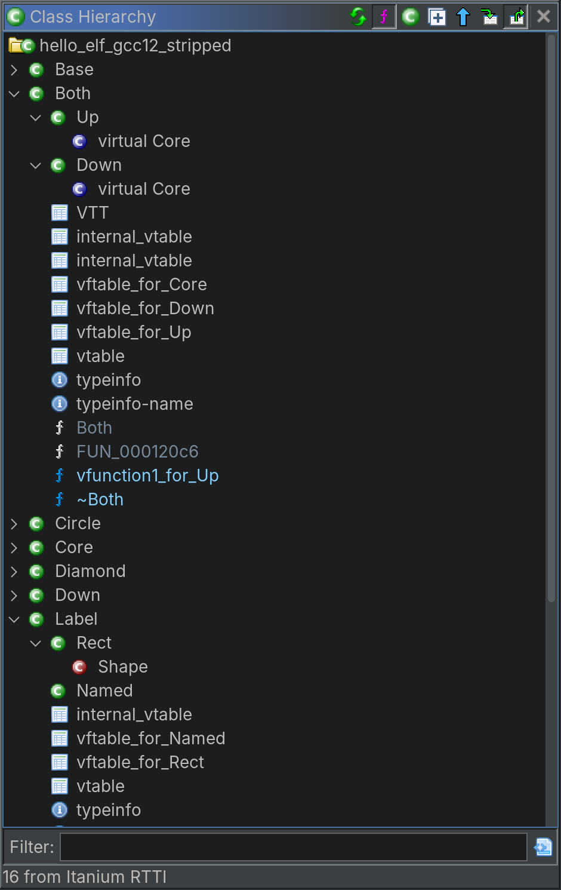
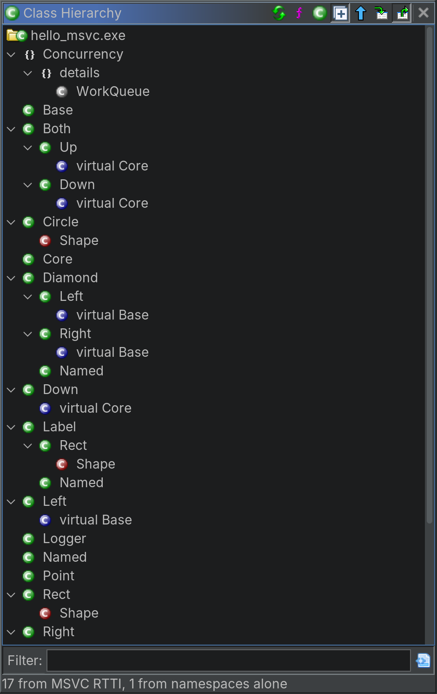
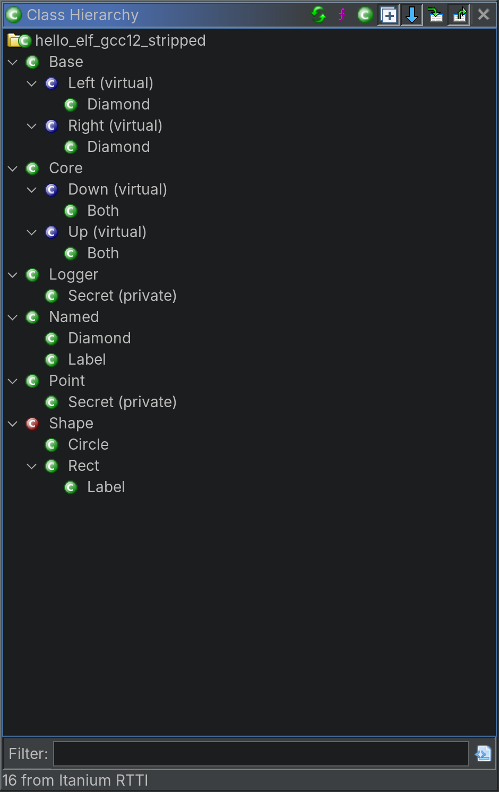

# ghicpp
[](https://github.com/unusual-thoughts/ghistabs/releases)
[](https://github.com/unusual-thoughts/ghistabs/releases)
[](https://github.com/unusual-thoughts/ghistabs/releases)
[](https://github.com/unusual-thoughts/ghistabs/releases)
[](https://github.com/unusual-thoughts/ghistabs/releases)
[](https://github.com/unusual-thoughts/ghistabs/releases)

A Ghidra extension that fills in the C++ support Ghidra lacks, so reversing C++ feels like
reading classes rather than untangling function pointers.

<table>
  <tr>
    <td width="50%"></td>
    <td width="50%"></td>
  </tr>
  <tr>
    <td><em>A stripped gcc 12 ELF: classes, bases and members from the Itanium RTTI alone</em></td>
    <td><em>The same program built by MSVC: the whole hierarchy from MSVC RTTI</em></td>
  </tr>
</table>

Ghidra demangles names and can lay out MSVC RTTI, but it has no idea of class inheritance: a class
is just a namespace, its bases are not recorded anywhere, and there is no view of the hierarchy.
Recovering classes from RTTI means running `RecoverClassesFromRTTIScript` by hand, once per
program, and it knows nothing of gcc 2.x, or of binaries built without RTTI. ghicpp makes all of
this part of auto-analysis, for gcc (GNU v2 and Itanium ABIs) and MSVC / clang-cl alike, and adds a
**Class Hierarchy** window to browse and fix up the result.

| | Ghidra alone | With ghicpp |
|---|---|---|
| **Class inheritance** | not recorded; a class is a namespace | each class's bases, with virtuality and access, saved in the program |
| **Hierarchy view** | none | `Window > Class Hierarchy`: bases, derived classes, members, editable |
| **Itanium (gcc 3+) RTTI** | demangled labels only | typeinfo structs laid, labels put back on stripped binaries, classes recovered |
| **gcc 2.x vtables** | untyped data | `<Class>_vftable` structs with typed slots |
| **No RTTI at all** | nothing | opt-in: vtables found as tables of function pointers, classes recovered from them |
| **Virtual functions** | wherever analysis left them | moved into the class that introduced them |
| **Constructors and destructors** | unnamed functions | found by the vtables they store, named, given `__thiscall` |
| **Class structs** | placeholder from the demangler, or a manual script run | sized and laid on every analysis: bases, `vfptr`s, `vbptr`s, virtual bases, constructor-stored fields, member objects |
| **Virtual calls** | `vfptr[N]` past the end of the root's vftable | each class's own `{vfptr}` typed to its own vftable, so calls name their slot |
| **Methods called on objects** | free functions | moved into the class whose objects their callers pass |

It also carries the gcc and MinGW fix-up analyzers that grew alongside it, since they make the same
C++ binaries decompile cleanly: SJLJ exception tables, struct returns, deferred stack pops,
alignment padding and non-returning functions.

ghicpp is its own Gradle project and its own extension inside the
[ghistabs](https://github.com/unusual-thoughts/ghistabs) repo, and knows nothing of stabs.
ghistabs, the STABS importer, builds on it and bundles it: when a binary has stabs, ghistabs
records its classes from them, and ghicpp's passes and window work on those records the same way.

## What it gives you

- **Class records.** Each class's bases, with virtuality and access, from Itanium or MSVC RTTI,
  saved in the program so every later pass and the window read the same record.
- **Virtual functions in their classes.** Each virtual function moves into the namespace of the
  class that introduced it, and the slots of every vtable are typed off the functions they point
  at. A slot pointing at code with no function gets one.
- **Constructors and destructors.** Found by the vftables they store through `this`, named
  (`Foo`, `~Foo`, `` `scalar_deleting_destructor' ``) and given the right calling convention.
  Constructors inlined after `operator new` are read too: the vtables stored into what `new`
  returns name the class built, and the variable holding it is typed as a pointer to that class.
- **Class structs.** Sized from `operator new` where possible, and laid as Ghidra's
  `RecoverClassesFromRTTIScript` lays them: non-virtual bases at their offsets, a `vfptr` at each
  vptr typed to its vftable struct, `vbptr`s, virtual bases, and the fields the constructors
  store, typed by Ghidra's own struct filler. A field a constructor fills in a loop or with
  `memset` becomes an array, and a member object a constructor builds in place gets a class of its
  own, laid inside the class holding it. Without RTTI, an object constructed on what `operator new`
  allocates gets one too. See [Virtual function pointer models](#virtual-function-pointer-models)
  for how a derived class's `{vfptr}` is typed.
- **Classes without RTTI.** An opt-in analyzer finds vtables as tables of function pointers that
  code takes the address of, groups each secondary vtable with its primary, and recovers classes,
  constructors, destructors and virtual bases from them as the RTTI analyzers do.
- **Methods from `this`.** Unnamed functions called on an object move into the class of the
  objects their callers pass, with an Analysis bookmark on each guess, and every method gets a
  calling convention that takes `this`.
- **Readable exception handling.** On MinGW SJLJ binaries, typed LSDA tables and a typed unwind
  context, with a comment at each call site saying what happens if it throws.
- **Cleaner gcc decompilation.** Correct struct returns, deferred argument pops and padding, so
  the decompiler stops showing stores through stray pointers.

## Supported configurations

|                      | Supported                                                                                     |
| -------------------- | --------------------------------------------------------------------------------------------- |
| **Ghidra**           | **10.4 - 12.2**                                                                               |
| **Binary containers**| **PE/COFF** and **ELF**                                                                       |
| **Instruction sets** | `i386` / `x86-64`; the fix-up analyzers that read x86 stack code are 32-bit x86 only          |
| **C++ ABIs**         | GNU v2 (gcc 2.x), Itanium (gcc 3+), MSVC (MSVC and clang-cl)                                  |
| **Also**             | stripped binaries, as long as the RTTI survives; binaries with no RTTI, through the opt-in *Vftables from pointer tables* |

## Install

Grab the prebuilt `ghicpp` zip for your Ghidra version from the
[ghistabs releases page](https://github.com/unusual-thoughts/ghistabs/releases), or build one (it
lands in `ghicpp/dist/`). Then either

- **Ghidra GUI:** `File > Install Extensions… > +`, pick the zip, restart Ghidra; or
- **Gradle:** `./gradlew :ghicpp:installExtension` (builds and extracts into your Ghidra user
  extensions dir; set `GHIDRA_USER_DIR` to override), then restart Ghidra.

**With ghistabs:** the ghistabs zip already contains ghicpp, so stabs users install only
ghistabs. The ghicpp zip is for binaries without stabs.

## Using it in Ghidra

### Analyzers

All are re-runnable and available as one-shot analysis, and all but *Vftables from pointer
tables* are enabled by default. Ghidra runs them in order of priority, earliest first.

| Analyzer | Priority | Runs on | What it does |
|---|---|---|---|
| **Itanium RTTI symbols** | `FORMAT_ANALYSIS` + 1 | gcc 3+ | Puts back the `_ZTS`/`_ZTI`/`_ZTV` labels a stripped binary lost, from the RTTI it kept. Runs early, so everything keyed off those symbols sees them. |
| **In-Function Gap Disassembler** | `FUNCTION_ANALYSIS` + 1 | any | Disassembles undefined bytes *inside* a function's extent: hot/cold split holes and exception landing pads reachable only by unwinding. Only where every byte of the gap decodes cleanly. |
| **GCC SJLJ exception tables** | `LOW_PRIORITY` − 2 | MinGW gcc, SJLJ | Lays the LSDA (`.gcc_except_table` entry) of every function with SJLJ exceptions: header, call-site, action and type tables, typed and commented, labelled `lsda`. Ghidra's `GCC Exception Handlers` finds LSDAs through `.eh_frame`, which an SJLJ binary lacks. The tables are found through the prologue that fills the unwind context, so stripped binaries are covered too. |
| **Filler Byte Condenser** | `LOW_PRIORITY` − 1 | any | Collapses GAS `.p2align` padding in code (NOP idioms and the jump-over-fill form) into `Alignment` data, so it isn't mistaken for undescribed data. |
| **GCC SJLJ unwind context** | `LOW_PRIORITY` + 1 | MinGW gcc, SJLJ | Types each function's unwind context as a local `fc` of type `SjLj_Function_Context`, and the `_Unwind_SjLj_*`, personality and `__cxa_*` calls, so the decompiler shows `fc.call_site = 2` instead of raw stack slots. Each `fc.call_site` store gets a comment saying what its LSDA entry does if the call throws. |
| **C++ method calling convention** | `LOW_PRIORITY` + 1 | any C++ | Makes each class method's convention take `this`: a `__fastcall` that takes nothing in `EDX` becomes the `__thiscall` it is, and a method *Decompiler Parameter ID* committed in custom storage gets its automatic `this` back. The class passes, which run later, do the same to every function they place in a class, virtual functions included. |
| **Non-returning functions (reachability)** | `LOW_PRIORITY` + 1 | any | Marks a function non-returning when every path ends in a call to a non-returning function, such as a project `error()` that calls `exit`. |
| **Struct-return ABI (x86 gcc)** | `LOW_PRIORITY` + 2 | x86:LE:32 gcc | gcc returns a class in memory whenever it is non-trivial for calls, whatever its size, which `x86gcc.cspec` can't express. Reads the callee's stack purge (`RET 0x4` vs bare `RET`) and, where it disagrees with the cspec, moves the function to a derived convention (`__thiscall_memret`, `__cdecl_regret`, …). |
| **GCC C++ vftables** | `LOW_PRIORITY` + 2 | gcc (Itanium `_ZTV…`, gcc 2.x `_vt…`) | Lays a `<Class>_vftable` at every vtable symbol, each slot typed off the function it points at, under the class namespace with the labels Ghidra's RTTI scripts use (`vftable`, `vftable_for_<Base>`, …). |
| **Itanium typeinfo** | `LOW_PRIORITY` + 2 | gcc 3+ | Lays the `__class_type_info`, `__si_class_type_info` or `__vmi_class_type_info` struct its vtable pointer names at every `_ZTI…`, a vmi one's base array sized to its base count. It also fills in the empty structs Ghidra makes for the `this` of the `__cxxabiv1` typeinfo classes' own methods. |
| **MSVC RTTI classes** | `LOW_PRIORITY` + 2 | MSVC / clang-cl PE | Off the RTTI that Ghidra's `Windows x86 PE RTTI Analyzer` laid, each class's bases and vftables go to the class pass the Itanium one shares: it records the bases for the Class Hierarchy window, moves each virtual function into the class that introduced it, and finds constructors and destructors by the vftables they store through `this`, and a destructor that stores none by the deleting destructor that calls it. It names them (`Foo`, `~Foo`, `` `scalar_deleting_destructor' ``) and gives each function it places, virtual functions included, a method's convention as *C++ method calling convention* does. Each class gets a struct where `RecoverClassesFromRTTIScript` files one, of its size (exact from `operator new`, else at least what its bases, vptrs and constructor stores reach), filled as the script fills it: each non-virtual base at its offset, a `vfptr` at each vptr typed to its `<Class>_vftable` or `<Class>_vftable_for_<Base>` struct, a `vbptr` where a constructor stores a vbtable, the virtual bases after, and the fields its constructors store in `<Class>_data`. A struct something else filled, or a second analysis finds filled, is left alone. A base holding a vptr is split around it (`vfptr`, then the base's `<Base>_fields_<from>_<to>`) under its **Virtual function pointer model** option, `SPLIT_BASE` by default; `INHERITED` keeps the base whole with its own `vfptr`, typed to the base's vftable. It splits every base holding one, secondary and virtual ones too. Its **Arrays from fill loops** option, on by default, types a field a constructor fills in a loop counted down from a constant (x86 `rep stos`), or with `memset` of a constant size, as an array. Its **Constructors inlined after new** option, on by default, reads a constructor the compiler inlined after `operator new(size)`: the vptrs stored at the start of what it returns, in order, are bases before the class they build, the last one stored is that class, of the `new` size, and the fields stored and members built there are theirs. |
| **Itanium RTTI classes** | `LOW_PRIORITY` + 3 | gcc 3+ | What *MSVC RTTI classes* does, off the Itanium RTTI: classes from the `typeinfo` labels, their bases from the typeinfo, their vtables from *GCC C++ vftables*' `vtable` labels. Its structs are filled alike, each virtual base at the offset the vtable gives, and it has the same **Virtual function pointer model**, **Arrays from fill loops** and **Constructors inlined after new** options. With *Itanium RTTI symbols*, this covers stripped binaries. A program whose classes ghistabs already recorded from stabs is left alone. |
| **Deferred stack pops (x86)** | `LOW_PRIORITY` + 3 | x86 gcc | Finds where two paths meet with `ESP` apart because gcc left a call's arguments pushed, and pops the dead bytes at that call through a call-site override (`__cdecl_pop16`, …), kept only if the decompiler then makes fewer stores through pointers. Also gives MinGW `_Name@N` import stubs their `N`-byte purge. Enabled by default for gcc programs only. |
| **Itanium virtual bases** | `LOW_PRIORITY` + 3 | gcc 3+ | Places the virtual bases a class struct lacks, at the offset its `_ZTV` gives, as its typeinfo names them. When nothing defines a virtual base, places the first base of it that something does. The RTTI class passes place virtual bases the same way, MSVC's off the vbtable. |
| **Vftables from pointer tables** | `LOW_PRIORITY` + 4 | any C++, off by default | For a program whose RTTI no class analyzer reads, absent or in an unknown format. Finds vtables by their shape: a run of words pointing at functions, beginning at one that code takes the address of (not a call, jump, read or write through it), ending at the next such word, a symbol, data laid other than one plain word, or past two nulls (gcc leaves an abstract class's destructor slots null). Each becomes the `vftable` of a class `Klass_<address>`, laid as a `<Class>_vftable`, and goes through the class pass: slots made functions and moved in, constructors and destructors found by their stores, the class sized and filled. A class's base is the class whose vtable a structor's call on `this` stores, or which introduced the slots its table shares with others, the one with the shortest table, unless it overrides a slot the class inherits from further up. Bases at an offset are not inferred. Its **Classes of member objects** option, on by default, gives a class to each member a constructor builds at `this` + k with a function that stores no vptr (the first called there in a constructor, the last in a destructor). It has no vtable, so it is named `NPKlass_<address>` after its first constructor's address, not a table's, as its struct's description says. It is sized off its constructor's stores and laid in the holding class at k, as is a class with a vtable built there. It also has the **Virtual function pointer model**, **Arrays from fill loops** and **Constructors inlined after new** options. Its classes are evidence for *Method classes from this*, which runs after it. Run it once most of the program is disassembled and its references marked, and again after: a rerun finds tables the code it made refers to, and cuts a table it seeded where code now refers into it; a one-time rerun is followed by one of *Method classes from this*, when it is enabled, with its own options. |
| **Method classes from this** | `LOW_PRIORITY` + 5 | any C++ | Moves each unnamed global function whose first argument comes in where `this` does into the class of the objects its callers pass it. The evidence is the classes the class record holds: a method of one calling on its own `this` or on the member object or base its class's struct lays at an offset into it, or any function calling on an object it built with one of their constructors. A method is also called on its derived classes' objects, so where callers pass several classes it goes to the one they all lead to through the bases they share their address with (non-virtual, at offset 0), and nowhere where none does. A guess is not evidence for another. Under MinGW gcc before 4.7, which passes `this` on the stack, a `__cdecl` counts too (`this` second when it returns a class in memory), so a free function taking an object first can't be told from a method. Runs after the class passes, *Vftables from pointer tables* included, and leaves an Analysis bookmark on each guess. A rerun over an unchanged program moves nothing more, so a run right after another, with no change by an analyzer, a user or an option between, returns at once. Its **Trust guessed method classes** option, off by default, counts its own guesses (this run's and earlier runs') as evidence too, and guesses again off the calls they make, round after round until nothing more moves. |

#### Class analyzer options

*MSVC RTTI classes*, *Itanium RTTI classes* and *Vftables from pointer tables* share the first three
options (`Analysis > Auto Analyze… > <analyzer>`):

| Option | Default | Effect |
|---|---|---|
| **Virtual function pointer model** | `SPLIT_BASE` | Where a polymorphic class's `{vfptr}` comes from; see [below](#virtual-function-pointer-models). ghistabs' importer has the same option, under the same name and default. |
| **Arrays from fill loops** | on | Types a field a constructor fills in a loop counted down from a constant (as x86's `rep stos` does) or with a `memset` of constant size as an array. |
| **Constructors inlined after new** | on | Reads the vtables, fields and member constructors that code stores into or calls on what `operator new(size)` returns as a constructor inlined there: the last vtable stored is the class built, of that size, each one before it a base of the next. |
| **Classes of member objects** | on | *Vftables from pointer tables* only. Gives a class to each member a constructor builds at an offset into `this` with a function that stores no vtable, and lays it in the class holding it. Also gives a class to what `operator new` allocates with a constant size and then calls a constructor on, at least as large as allocated. |
| **Trust guessed method classes** | off | *Method classes from this* only. Counts its own guesses as evidence, and guesses again off the calls they make until nothing more moves. |

#### Runtime functions worth labelling

The class analyzers (*MSVC RTTI classes*, *Itanium RTTI classes* and *Vftables from pointer tables*), and the
Class Hierarchy window, know a few runtime functions by name. An import or a symbol names them already. In a
stripped program with the runtime linked in, they are unnamed `FUN_…`, so label them before running the
analyzers, or rerun the analyzers once they are labelled. A call through a thunk counts as a call to the
function.

| Function | Names it goes by | Used by | Unlabelled |
|---|---|---|---|
| `operator new` | `operator_new`, `operator new`, `??2@YAPAXI@Z`, `_Znwj`, `__builtin_new`, … | The class pass, which every class analyzer runs: a constructor called on what `new(size)` returned sizes its class at least `size`. | Classes are sized only off the furthest field their constructors store, and short of any trailing field they leave unset. |
| `operator delete` | `operator_delete`, `operator delete`, `??3@YAXPAX@Z`, `_ZdlPv`, `__builtin_delete`, … | The class pass: a vtable slot that frees `this` with it is a deleting destructor, and the destructor it calls is found from it. | Each deleting destructor is named a plain destructor, and the destructor it calls is not found. |
| The pure virtual stub | `_purecall` (MSVC), `__cxa_pure_virtual` and `__cxa_deleted_virtual` (Itanium), `__pure_virtual` (gcc 2.x) | The class analyzers leave a slot holding it out: it is not a virtual method of the class, nor a slot two tables share. The Class Hierarchy window shows a class abstract by it, and the slots' override chains skip it. | The stub is taken for a virtual method, and moved into the base the classes holding it share, if they have one. *Vftables from pointer tables* takes the tables holding it in the same slot for a base's and its derived classes', and infers wrong bases off it. No class shows abstract. |
| `memset` | `memset`, `_memset` | The **Arrays from fill loops** option: a constructor's `memset(this + k, c, n)`, with `n` constant, lays an array at k. | Only inline fills (`REP STOSD`, or a store loop) are seen. |

Ghidra's `RecoverClassesFromRTTIScript` skips any vtable that already has a struct under `/ClassDataTypes`, so after
*GCC C++ vftables* it recovers nothing for those classes and retypes their methods' `this` to an empty placeholder: run it
on a program analysed with that analyzer off. The script also refuses to run at all once `/ClassDataTypes` exists, and
*MSVC RTTI classes*, *Itanium RTTI classes* and *Itanium typeinfo* all file structs there: turn them off too.

### Virtual function pointer models

A derived class shares its vptr with its primary base, so its class struct has to decide how that
pointer is typed. The *Virtual function pointer model* option picks one of two layouts.

**`SPLIT_BASE`** (the default) gives every polymorphic class a `{vfptr}` typed to its own
vftable, and embeds the base that holds the vptr as that base's fields without it: a
`<Base>_fields_<from>_<until>` run on each side of the pointer, in place of the whole base.

- Every polymorphic class's `{vfptr}` points at its own vftable, so calls resolve to named slots,
  including the ones it adds, with the class's own signatures.
- Decompiled virtual calls read cleanly at any level of the hierarchy.
- But the class no longer contains the base type, only a `<Base>_fields_X_Y` copy, so
  `&this->_base_` isn't a `Base *`, and upcasts and calls taking the base show casts.
- Ghidra's own class tools don't see the base as a prefix.
- There is one extra struct per polymorphic base, and edits to a class struct have to know about
  the runs.

**`INHERITED`** keeps one `{vfptr}` on the root of each hierarchy, shared through the embedded
base.

- The layout is literally the real one, the same as PDB, DWARF and Ghidra's own layouts. The base
  is embedded whole, so upcasts are typed and there are fewer types.
- But there is one vftable type per hierarchy root. A derived class's added slots overrun it and
  show as `vfptr[N]` or offsets, and overrides keep the base's signatures.

In short, `SPLIT_BASE` gives better virtual calls and `INHERITED` gives better upcasts and
base-typed code. For reverse engineering virtual-heavy code, `SPLIT_BASE` is the better default.

### `Window > Class Hierarchy`

A tree of the program's C++ classes, each under its namespace, modelled on the *ClassTypeInfo Tree* of [Ghidra-Cpp-Class-Analyzer](https://github.com/astrelsky/Ghidra-Cpp-Class-Analyzer).

Each class expands into its direct bases, spelled as the base clause would (`virtual Base`,
`private Impl`), and then its members: its vtables, its typeinfo, and its functions and labels.
Virtual functions are listed in slot order, with the slot in their tooltip, and the rest by name.
With *Show Inherited Slots* on, the slots that still hold a base's function are listed too, as
`Base::f` in a muted colour, and *Go to Base Method* selects the method in the class defining it.
Overloads carry their parameter types, and constructors and destructors their variants
(`[complete]`, `[base]`, `[deleting]`). Icon colours say what kind of class each one is (abstract,
virtual base, nested, or grey when its bases are unknown) and what is known of each member
(access, virtual or static, const). Toolbar toggles show or hide each kind of member (functions,
labels, vtables, typeinfo) and classes with nothing in them, and the tree can be inverted, so that
each class expands into the classes derived from it.

<p align="center">
  
  <br>
  <em>Inverted, members hidden: each class expands into the classes derived from it</em>
</p>

The window also edits, and every edit goes into the same class record the analyzers write:

- **Classes:** rename a class or namespace (its struct, vftables and `_data` follow), open its
  struct or vtable struct, and add or change a base by dropping one class on another, or respell
  an existing base clause with *Edit Base Attributes*.
- **Members:** move members between classes by drag and drop, rename or delete them, set their
  access, virtuality and cv-qualifiers, and show references to them.
- **Virtual slots:** rename a slot across the hierarchy, apply slot names or a method's signature
  to every vftable that holds it, name a destructor slot after each class, and go to the function
  a method overrides.
- **Fields:** update a class struct's field types from one method, or from all of the class's
  methods at once.

Where it gets its information:

- **Classes and bases** come from the class record, written by the class analyzers or by
  another extension such as ghistabs. A class with no record but an Itanium typeinfo takes its
  bases from the typeinfo bytes.
- **Members** are the class namespace's symbols. Virtuality is read off the vtable slots and
  const/volatile off the mangled name, unless the record says otherwise.
- **Abstract classes** are those with a vtable slot holding the pure virtual stub: `_purecall`
  (MSVC), `__cxa_pure_virtual` (Itanium) or `__pure_virtual` (gcc 2.x).

Vtables follow Ghidra's RTTI-script naming, so a class with several vftables has
`vftable_for_<Base>` labels and `<Class>_vftable_for_<Base>` structs.

When a program has RTTI but no record yet, the window says which analyzer to run.

## Building

Requires a Ghidra install and a JDK: 21 or later from Ghidra 11, 17 for 10.x. API differences
between Ghidra releases are absorbed by ghidrakt's `kotlin-pre*` / `kotlin-since*` compat source
sets, picked by the version of the install you build against. From the repo root:

```bash
export GHIDRA_INSTALL_DIR=/opt/ghidra   # or pass -PGHIDRA_INSTALL_DIR=...
./gradlew :ghicpp:buildExtension        # zip under ghicpp/dist/
./gradlew :ghicpp:installExtension      # build + install into the Ghidra user dir
./gradlew :ghicpp:test                  # unit tests
./gradlew :ghicpp:integrationTest       # headless Ghidra tests over the fixtures
```

The repo holds three Gradle projects, each depending on the one below it, plus the build logic:

| Path | What it is |
|---|---|
| `/` (root) | ghistabs: the stabs import, render, exporters and CLI, an extension that bundles ghicpp |
| `ghicpp/` | this extension: the class passes, the ABI readers, the gcc/MinGW fix-ups and the Class Hierarchy window |
| `ghidrakt/` | Kotlin helpers over the Ghidra API (program, data type and option extensions, diagnostics, compat shims), shipped inside the extension's jar set |
| `build-logic/` | the Gradle plugins every project uses: extension packaging, the compat source sets, fixture-generated tests |

ghicpp must build without the stabs project, and CI builds it on its own first. Its integration
suite runs in its own CI job, only when ghicpp or what it depends on changed.

## Testing

The fixtures under `ghicpp/src/test/resources/binaries/features/` are builds of one `hello.cc` by
gcc 2.7.2 through 12 (ELF and MinGW), MSVC and clang-cl, stripped gcc 12 and MinGW builds, and an
x86-64 gcc 13 build without RTTI, with and without symbols; their `README.md` says how each was
built. The integration tests run the analyzers over them, and a class recovery scorecard compares
what the analyzers recover against ground truth, with baselines CI fails on when they move. See
`TESTING.md` at the repo root for the test tiers and flags.

## Prior art

- [astrelsky/Ghidra-Cpp-Class-Analyzer](https://github.com/astrelsky/Ghidra-Cpp-Class-Analyzer) -
  class recovery from RTTI for gcc and MSVC; its *ClassTypeInfo Tree* is the model for the Class
  Hierarchy window. Does not load on Ghidra 12.x.
- Ghidra's own `RecoverClassesFromRTTIScript` - whose struct layout and labels ghicpp follows, so
  its output and Ghidra's read the same.
- [Itanium C++ ABI](https://itanium-cxx-abi.github.io/cxx-abi/abi.html) - vtable, typeinfo and
  mangling layout.
